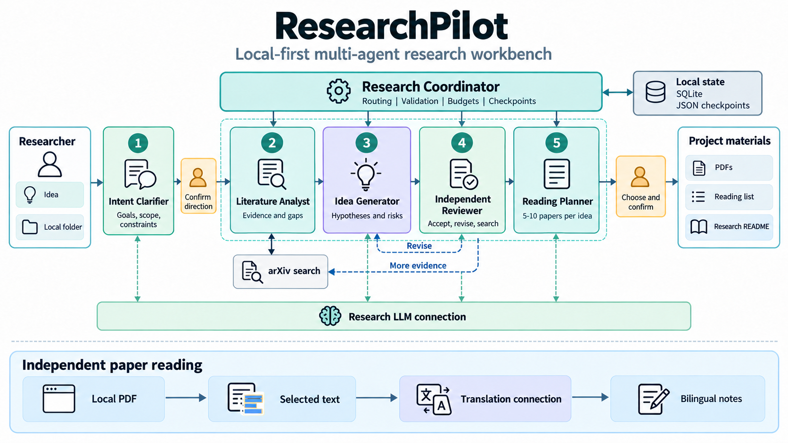
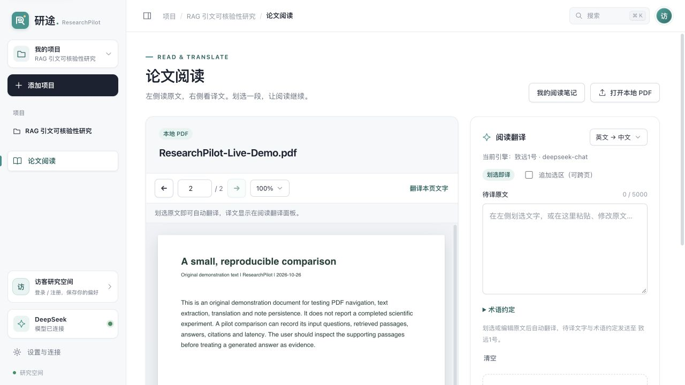

<div align="center">

# 研途 ResearchPilot

**以本地项目为中心的多智能体科研工作台**

From a research idea to evidence, candidate directions, and a reading plan.


[](LICENSE)

[在线体验](https://researchpilot-cryptic.cryptic3036.chatgpt.site) · [系统架构](#系统架构) · [快速开始](#快速开始) · [模型配置](#模型配置) · [研究流程](#研究流程) · [输出与追溯](#输出与追溯)

</div>

ResearchPilot 将想法梳理、文献分析、研究方向比较和论文阅读组织在一个本地工作台中。用户先绑定自己的项目文件夹，再通过对话明确研究目标与条件；五类专业 Agent 在程序协调器管理下分析文献、提出假设、审查问题并编排阅读清单。研究方向与资料保存由用户确认，过程状态和产物保存在本机。

> **在线站点仅供界面浏览与基础交互体验，研究流程使用固定示例。** 使用真实科研协作、文献检索、模型翻译和项目文件保存功能，需要下载源码，在本机启动服务并配置实际可用的模型连接。

## 系统架构



图中展示网页主流程的实现：五类 Agent 共用科研任务连接，协调器负责路由、工具调用、输出校验、预算和检查点；论文阅读使用独立的翻译连接。图中的资料输出发生在相应校验通过且用户确认保存之后。

## 核心特性

- **以项目文件夹组织研究**：绑定已有目录，按项目隔离研究状态，支持项目切换、归档与恢复。
- **五类角色协作**：意图澄清、文献研究、选题生成、独立审查和阅读策划分别接收适合自身任务的结构化上下文。
- **按证据与反馈推进**：缺少来源时补检索，假设或方法有问题时修订；达到预算或缺少新线索时交由用户决定。
- **保留过程与依赖**：记录模型和工具调用、输入产物 ID、输出、运行状态与检查点，支持从未完成步骤继续。
- **独立论文阅读**：在浏览器中打开本地 PDF，翻页、缩放、提取或划选文字，调用翻译服务并保存双语笔记。
- **轻量本地运行**：后端使用 Python 标准库，前端为原生 HTML、CSS 和 JavaScript，PDF.js 资源随项目提供。

## 快速开始

### 1. 获取与启动

需要 **Python 3.9+**。从[源码页面](https://github.com/Cryptic0429/ResearchPilot)下载 ZIP 并解压，在包含 `run.py` 的目录中运行：

```bash
python3 run.py --open
```

默认访问地址：**http://127.0.0.1:8765**。

应用运行无需安装第三方 Python 包或 Node.js。macOS 可运行 `start.command`，Windows 可运行 `start.bat`，也可使用：

```powershell
py -3 run.py --open
```

### 2. 配置模型连接

进入 **设置与连接**，分别配置“科研任务连接”和“文献翻译连接”。填写服务地址、实际可用的模型 ID、协议、认证方式和 API Key，保存后检查连接。具体字段见[模型配置](#模型配置)。

### 3. 开始使用

创建项目并选择一个已有本地文件夹，输入研究兴趣、问题及资源条件。根据追问补充信息，确认方向后启动文献与多 Agent 协作。论文阅读器可直接打开，不要求先创建项目。

### 启动选项

```bash
# 使用其他端口
python3 run.py --port 8766 --open

# 指定应用数据目录
python3 run.py --data-dir /path/to/researchpilot-data --open

# 仅启动服务，不自动打开浏览器
python3 run.py
```

服务监听本机回环地址 `127.0.0.1`，适用于本地工作台场景。

## 模型配置

### 两类独立连接

| 用途 | 承担的任务 | 配置要点 |
| --- | --- | --- |
| 科研任务连接 | 意图澄清、证据分析、Idea 生成、独立审查、阅读策划 | 使用具备相应模型权限与额度的科研服务 |
| 文献翻译连接 | PDF 选段或粘贴文字的翻译、术语约定 | 单独配置；校内服务需要满足其网络访问条件 |

两类连接的地址、协议、模型和密钥分别管理。科研连接失败时不会自动改用翻译连接。保存配置不调用模型；检查连接与实际使用可能消耗服务额度。

### 支持的协议

| 界面协议 | 环境变量值 | 相对于 Base URL 的请求路径 | 常用认证 |
| --- | --- | --- | --- |
| OpenAI Chat Completions | `chat_completions` | `/chat/completions` | Bearer |
| OpenAI Responses | `responses` | `/responses` | Bearer |
| Claude Messages | `anthropic_messages` | `/messages` | `x-api-key` |
| Gemini generateContent | `gemini` | `/models/<model>:generateContent` | `x-goog-api-key` |

Base URL 应填写服务提供的接口根地址，例如带 `/v1` 或 `/v1beta` 的根路径，不重复添加具体推理端点。模型 ID 以自己的服务账号实际可用列表为准；协议和认证方式按服务说明选择。

### 通过环境变量配置访客空间

也可在启动应用的同一终端中设置以下变量。示例中的服务地址、模型和密钥都需要替换为自己的有效配置：

```bash
export RP_RESEARCH_PROVIDER="Research service"
export RP_RESEARCH_API_BASE="https://your-research-provider.example/v1"
export RP_RESEARCH_MODEL="your-research-model"
export RP_RESEARCH_API_KEY="your-research-api-key"
export RP_RESEARCH_API_STYLE="chat_completions"
export RP_RESEARCH_API_AUTH="bearer"

export RP_TRANSLATION_PROVIDER="Translation service"
export RP_TRANSLATION_API_BASE="https://your-translation-provider.example/v1"
export RP_TRANSLATION_MODEL="your-translation-model"
export RP_TRANSLATION_API_KEY="your-translation-api-key"
export RP_TRANSLATION_API_STYLE="chat_completions"
export RP_TRANSLATION_API_AUTH="bearer"

python3 run.py --open
```

应用不会自动加载 `.env`。环境变量凭据用于访客空间；登录账号使用自己在界面中保存的独立连接。访客密钥只在服务进程内存中保留；账号凭据依赖本机文件权限保护，没有额外加密。

## 研究流程

```text
研究想法 → 意图澄清 → 用户确认方向
                         ↓
                  文献检索与证据分析
                         ↓
                    候选 Idea 生成
                         ↓
                      独立审查
                    ↙          ↘
             补检索 / 修订      阅读策划
                                  ↓
                         用户选择并确认保存
                                  ↓
                         本地论文与研究说明
```

### 1. 梳理研究意图

输入研究对象、问题、目标、时间与可用资源，也可以从模糊兴趣开始。意图澄清 Agent 整理条件与未知项，给出追问和可选方向。是否能够确认取决于信息就绪程度，不强制对话轮数；就绪判断不代替用户确认。

### 2. 基于文献比较研究方向

用户确认方向后，协调器执行 arXiv 检索，再将题录与摘要交给专业角色处理。

| Agent | 主要职责 | 结构化产物或决定 |
| --- | --- | --- |
| 意图澄清 / Intent Clarifier | 明确目标、对象、条件与未知项 | 研究意图、检索主题、就绪判断 |
| 文献研究 / Literature Analyst | 分析来源、贡献、关联与限制 | 逐篇证据表、证据缺口、补检索主题 |
| 选题生成 / Idea Generator | 形成或修订候选方向 | 可证伪假设、最小验证方案、风险、核心来源 |
| 独立审查 / Independent Reviewer | 核对意图、证据和候选假设 | `accept`、`revise` 或 `search`，以及具体修改要求 |
| 阅读策划 / Reading Planner | 为每个 Idea 编排阅读路径 | 阅读来源、顺序、理由、目标与未解决缺口 |

这些是不同任务契约的逻辑角色，当前共用科研任务连接，由协调器按阶段与反馈路由调用。“独立审查”指角色职责与审查上下文的区分。

### 3. 反馈、停止与恢复

协调研究轮次默认最多 **12 次模型调用、9 次检索、2 轮反馈修订**，失败调用也计入预算。意图澄清在该协调轮次之外记录。

- 证据不足：提出并执行新的检索主题。
- 假设需要调整：将审查意见交回选题生成。
- 阅读清单不完整：继续补充匹配来源。
- 预算耗尽或没有新线索：进入 `needs_input`，由用户决定继续一轮或调整方向。
- 调用或输出校验失败：保留检查点，重试尚未完成的步骤，复用仍有效的已完成产物。

“再推进一轮”最多增加 4 次模型调用、3 次检索和 1 轮修订。没有新检索主题时需要调整方向，避免重复查询。

### 4. 保存研究资料

在审查与阅读策划满足程序校验后，每个可选 Idea 的阅读清单包含 **5–10 篇**来源文献，覆盖近期研究与基础阅读，并说明阅读理由和目标。用户选择 Idea 并确认后，程序保存 PDF、阅读清单与研究说明。

已有的 `README.md` 会保留，研究说明改存为 `README.researchpilot.md`。遇到已有目标说明或清单时会提示处理，不覆盖同名资料。

## 论文阅读与双语笔记



*本地阅读界面，图中 PDF 为原创演示材料。*

论文阅读器独立于研究流程，可直接打开本地 PDF：

1. 点击 **论文阅读 → 打开本地 PDF**，进行翻页和缩放。
2. 划选文字，或使用 **翻译本页文字** 提取待译内容；也可手动粘贴并编辑原文。
3. 使用独立的翻译连接获得译文，可设置术语约定或追加跨页选区。
4. 点击 **保存双语笔记**，之后从 **我的阅读笔记** 重新打开。

PDF 留在浏览器中，翻译请求只发送待译文字、目标语言与术语约定。阅读笔记按账号或访客空间保存，不随项目切换清空。未保存的阅读记录和打开的 PDF 属于页面会话，刷新后需要重新打开。

当前本地 PDF 上限为 **50 MB**，单次翻译最多 **5000 字符**。扫描件需先做 OCR。

## 输出与追溯

### 绑定项目目录中的文件

资料保存步骤完成后，项目目录包含以下内容：

```text
your-project/
├── .researchpilot/
│   ├── research-flow.json          # 研究流程的 JSON 状态镜像
│   └── runs/
│       └── <run_id>.json           # 协调运行检查点
├── reference/
│   ├── <arxiv-id>.pdf              # 选定阅读清单的论文
│   └── reading-list-<idea-id>.json  # 来源、理由和阅读目标
└── README.md                      # 或 README.researchpilot.md
```

### 应用数据与过程记录

应用数据默认保存在程序目录的 `.researchpilot/`，也可通过 `--data-dir` 指定。账号、项目索引、研究状态和阅读笔记存入本地 SQLite；账号模型凭据使用独立文件保存。绑定项目文件夹中的 JSON 镜像与运行检查点用于保留研究过程。

每个产物包含项目 ID、运行 ID、角色、输入产物 ID、创建时间和经过校验的输出。模型与工具调用分别记录开始、完成、失败等状态。新的证据或反馈会使相关下游缓存失效，避免混用不同轮次的结论。

## 项目结构

```text
ResearchPilot/
├── run.py                         # 本地服务启动入口
├── researchpilot/
│   ├── server.py                  # HTTP API、会话与后台任务
│   ├── workspaces.py              # 项目作用域、目录绑定和归档
│   ├── project_flow.py            # 用户确认、研究流程与资料保存
│   ├── research_agents.py         # 五类研究角色与输出校验
│   ├── research_coordinator.py    # 路由、预算、缓存与检查点
│   ├── agents.py                  # 科研与翻译连接的调用上下文
│   ├── model_protocols.py         # 四类模型协议适配
│   ├── papers.py                  # arXiv 文献服务
│   ├── reader.py                  # 待译文字处理与翻译
│   ├── accounts.py                # 本机账号和个人偏好
│   ├── credentials.py             # 凭据文件管理
│   └── store.py                   # SQLite 存储
├── static/                        # 网页界面与 PDF.js 资源
├── assets/                        # README 总览图与界面截图
├── start.command                  # macOS 启动脚本
├── start.bat                      # Windows 启动脚本
└── LICENSE
```

## 常见问题

**没有 API Key 可以做什么？**  
可以启动界面、管理项目和阅读本地 PDF。真实研究推理与翻译需要各自可用的模型连接。

**为什么没有产生最终 Idea？**  
来源不足、模型返回不符合结构要求、审查存在重大问题或预算达到上限，都可能使流程暂停。查看当前状态，补充研究条件或新检索线索后再继续；已检索记录不等于通过审查的研究结果。

**为什么翻译可用，但科研任务不可用？**  
两者使用独立连接。请核对相应用途的地址、模型、认证、权限、网络和额度。

**账号是否是线上账号？**  
账号用于本机数据隔离和偏好保存，邮箱是本机登录标识；当前不发送验证或找回邮件。

## 适用范围

ResearchPilot 支持研究准备与文献阅读。当前研究检索来源为 arXiv，Agent 的证据分析主要依据题录和摘要。来源与结构校验不等于全文核验，也不保证新颖性、结论正确或实验有效。研究者需要核对原文，并实际验证假设与方法。

模型能力、服务权限、网络、额度与输出格式都会影响运行。公开体验站点、模拟接口测试和真实模型运行分别有不同的验证范围。

## 参考与致谢

- README 的组织参考 [HypoForge](https://github.com/Jyzan/HypoForge) 与 [PhysEval](https://github.com/Cryptic0429/PhysEval)。
- 系统总览图根据 ResearchPilot 的实现原创生成，视觉组织参考 [Agent Laboratory](https://aclanthology.org/2025.findings-emnlp.320/) 与 [The AI Scientist-v2](https://arxiv.org/abs/2504.08066) 的阶段化研究系统 overview。
- PDF 阅读使用 [PDF.js](https://github.com/mozilla/pdf.js)，随附组件与字体的许可见 [`static/vendor/pdfjs/`](static/vendor/pdfjs/)。

## 许可证

项目原创代码采用 [MIT License](LICENSE)。第三方组件、论文内容与外部服务分别遵循其适用的许可和使用条款。
